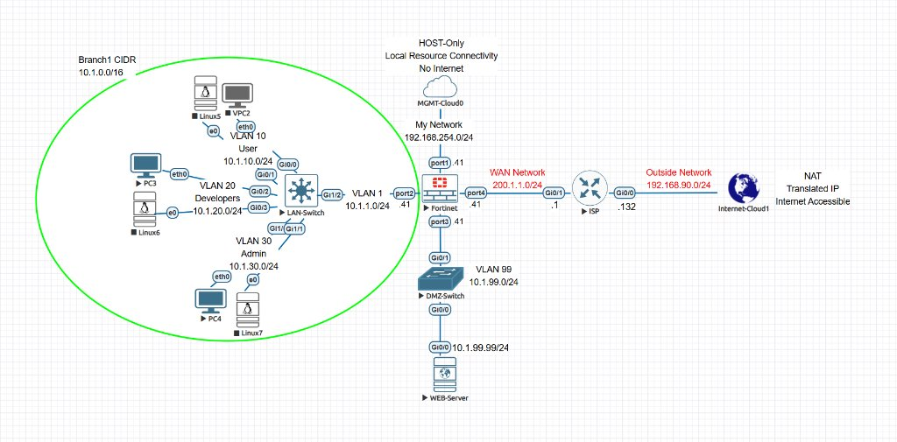

# Enterprise FortiGate NGFW Perimeter & Micro-Segmentation Lab

An advanced network security laboratory demonstrating enterprise perimeter protection, zone-based firewalling, dynamic OSPF routing, and DMZ server publishing using **FortiGate Next-Generation Firewall (FortiOS)** and **Cisco Layer 3 Switching**.

Designed and implemented by **[Rakesh Mehta](https://github.com/RakeshMehta01)**.

---

## 📌 Executive Summary

Modern enterprise networks require defense-in-depth, strict boundary isolation, and seamless routing convergence. This project simulates an enterprise branch and perimeter infrastructure featuring:

- **Perimeter Next-Generation Firewalling**: Centralized policy enforcement, stateful packet filtering, and deep traffic inspection with FortiGate VM.
- **Enterprise Micro-Segmentation**: 802.1Q VLAN separation for Corporate Users (`VLAN 10`), Software Developers (`VLAN 20`), and IT Administrators (`VLAN 30`).
- **High-Speed Inter-VLAN Core Routing**: Cisco Layer 3 switch offloading intra-campus traffic using Switch Virtual Interfaces (SVIs).
- **Dynamic Routing Convergence**: Single-area OSPF (Area 0) dynamic peering between Core LAN-Switch and FortiGate NGFW.
- **Isolated Demilitarized Zone (DMZ)**: Dedicated segment (`VLAN 99`) hosting a hardened web server (`pinglabs.in`) published to the WAN via Destination NAT (Virtual IP / Port Forwarding).
- **Carrier Edge Simulation**: Cisco edge router performing PAT (NAT Overload) toward the public Internet cloud.
- **Out-of-Band Management (OOBM)**: Dedicated host-only network (`192.168.254.0/24`) for secure administrative GUI and CLI management.

---

## 🗺️ Network Topology Architecture



### High-Level Zone Flow Diagram

```
                             [ Internet Cloud ]
                                     │
                                     │ (DHCP Outside)
                              ┌──────┴──────┐
                              │  ISP Router │ (Cisco 7200 / Edge PAT)
                              └──────┬──────┘
                                     │ 200.1.1.1/24
                                     ▼
                   [ Port 4: WAN ] 200.1.1.41/24
                 ┌─────────────────────────────────┐
                 │       FortiGate Core NGFW       │ ◄─── [ Port 1: OOBM ] (192.168.254.41/24)
                 └──────────────┬──────────────────┘
                                │
        ┌───────────────────────┴───────────────────────┐
        │                                               │
  [ Port 2: LAN ] 10.1.1.41/24                   [ Port 3: DMZ ] 10.1.99.41/24
        │ (Transit Subnet / OSPF)                       │ (Isolated VLAN 99)
        ▼                                               ▼
┌──────────────┐                                ┌──────────────┐
│  LAN-Switch  │                                │  DMZ-Switch  │
└───────┬──────┘                                └───────┬──────┘
        │                                               │
 ┌──────┼──────┐                                        ▼
 │      │      │                                 ┌──────────────┐
VLAN10 VLAN20 VLAN30                             │  Web-Server  │
(Users)(Devs) (Admins)                           │(10.1.99.99)  │
                                                 └──────────────┘
```

---

## 📊 Addressing & VLAN Scheme

| Domain / Node | Interface | IPv4 Address | Subnet Mask | Default Gateway | Function |
| :--- | :--- | :--- | :--- | :--- | :--- |
| **FortiGate NGFW** | `port1` | `192.168.254.41` | `255.255.255.0` | None | Host-Only GUI/SSH Management |
| **FortiGate NGFW** | `port2` | `10.1.1.41` | `255.255.255.0` | None | Core LAN Transit & OSPF Adjacency |
| **FortiGate NGFW** | `port3` | `10.1.99.41` | `255.255.255.0` | None | DMZ Gateway |
| **FortiGate NGFW** | `port4` | `200.1.1.41` | `255.255.255.0` | `200.1.1.1` | WAN Uplink to ISP Edge |
| **LAN-Switch** | `Loopback0` | `10.1.0.254` | `255.255.255.255` | N/A | OSPF Router ID & Loopback |
| **LAN-Switch** | `Vlan 1` | `10.1.1.254` | `255.255.255.0` | `10.1.1.41` | Transit SVI to FortiGate |
| **LAN-Switch** | `Vlan 10` | `10.1.10.254` | `255.255.255.0` | N/A | SVI Gateway for Corporate Users |
| **LAN-Switch** | `Vlan 20` | `10.1.20.254` | `255.255.255.0` | N/A | SVI Gateway for Developers |
| **LAN-Switch** | `Vlan 30` | `10.1.30.254` | `255.255.255.0` | N/A | SVI Gateway for Administrators |
| **ISP Router** | `Gi0/1` | `200.1.1.1` | `255.255.255.0` | N/A | WAN Edge Gateway (Inside NAT) |
| **ISP Router** | `Gi0/0` | DHCP Assigned | Dynamic | DHCP | Outside Public Internet Transit |
| **Web-Server** | `Gi0/0` | `10.1.99.99` | `255.255.255.0` | `10.1.99.41` | DMZ Published Host (`pinglabs.in`) |
| **User PC (VPC2)** | `eth0` | `10.1.10.2` | `255.255.255.0` | `10.1.10.254` | User Workstation (VLAN 10) |
| **Developer PC (PC3)**| `eth0` | `10.1.20.3` | `255.255.255.0` | `10.1.20.254` | Developer Workstation (VLAN 20) |
| **Admin PC (PC4)** | `eth0` | `10.1.30.3` | `255.255.255.0` | `10.1.30.254` | Admin Workstation (VLAN 30) |

---

## 🛡️ FortiGate Firewall Policies & Security Controls

| ID | Name | Source Zone | Destination Zone | Source Address | Destination Address | Services | Action | NAT Mode | Purpose |
| :---: | :--- | :---: | :---: | :--- | :--- | :--- | :---: | :---: | :--- |
| **10** | `LAN_to_Internet_Outbound` | `port2` (LAN) | `port4` (WAN) | `10.1.0.0/16` | `all` | HTTP, HTTPS, DNS, PING | **ACCEPT** | SNAT (Outgoing Interface) | Internal corporate workstations accessing external Internet |
| **20** | `LAN_to_DMZ_WebServer` | `port2` (LAN) | `port3` (DMZ) | `10.1.10.0/24`, `10.1.20.0/24`, `10.1.30.0/24` | `10.1.99.99` | HTTP, HTTPS, SSH, PING | **ACCEPT** | Disabled | Internal corporate access to DMZ Web Portal and SSH administration |
| **30** | `WAN_to_DMZ_WebServer_VIP` | `port4` (WAN) | `port3` (DMZ) | `all` | VIP `200.1.1.41:80` | HTTP (TCP/80) | **ACCEPT** | DNAT (Mapped to 10.1.99.99) | Inbound public web traffic forwarding to DMZ Web Server |
| **40** | `DMZ_to_Internet_Outbound` | `port3` (DMZ) | `port4` (WAN) | `10.1.99.0/24` | `all` | DNS, NTP, HTTP, HTTPS | **ACCEPT** | SNAT (Outgoing Interface) | DMZ servers fetching OS updates and time sync |
| **50** | `Admin_VLAN30_Management` | `port2` (LAN) | `port1` (MGMT)| `10.1.30.0/24` (Admin VLAN) | `192.168.254.41` | HTTPS, SSH, PING | **ACCEPT** | Disabled | Privileged firewall configuration access restricted to Admin VLAN |
| **0** | `Implicit Deny` | Any | Any | `all` | `all` | ALL | **DENY** | N/A | Drops all unauthorized inter-zone traffic |

---

## ⚙️ Core Technical Highlights

### 1. Dynamic Routing Integration (OSPF Area 0)
- **Router ID Allocation**: LAN-Switch uses `10.1.0.254` (Loopback 0); FortiGate uses `10.1.1.41`.
- **Dynamic Route Exchange**: FortiGate learns internal subnets (`10.1.10.0/24`, `10.1.20.0/24`, `10.1.30.0/24`) dynamically over transit link `10.1.1.0/24`.
- **Default Route Origination**: FortiGate originates default information (`0.0.0.0/0`) dynamically into OSPF, directing all egress traffic toward the firewall.
- **Access Port Hardening**: Host-facing switchports are configured as OSPF passive interfaces to suppress hello packets and mitigate rogue adjacency attacks.

### 2. Dual NAT Implementation
- **Source NAT (PAT)**: Inside private hosts (`10.1.0.0/16`) egressing through FortiGate Port 4 are translated to public IP `200.1.1.41`. The ISP router performs secondary PAT onto its dynamic cloud IP.
- **Destination NAT (Virtual IP / Port Forwarding)**: Public requests directed to `http://200.1.1.41:80` are rewritten by the FortiGate VIP engine and forwarded to private host `10.1.99.99:80`.

### 3. DMZ Zero Trust Isolation
- Traffic originating from the DMZ toward the internal LAN (`port3` -> `port2`) is completely denied by the Implicit Deny policy.
- In the event of a web server compromise, malicious actors cannot laterally traverse into employee workstations or management networks.

---

## 📁 Repository Directory Structure

```
Fortigate-Network-Security-Lab/
├── README.md                                  # Showcase documentation & project blueprint
announcements
├── diagrams/
│   └── topology.jpg                           # Full high-resolution lab network topology
├── docs/
│   ├── 01_network_topology_and_ip_plan.md    # Detailed subnetting and IP allocation plan
│   ├── 02_fortigate_security_design.md       # Security zones, policy matrix, and NAT mechanics
│   ├── 03_routing_and_switching_design.md    # L3 SVIs, dynamic OSPF, and route redistribution
│   ├── 04_dmz_and_server_hardening.md        # DMZ isolation and Cisco Web Server hardening
│   └── 05_verification_and_testing.md        # Verification runbook and validation command outputs
├── configs/
│   ├── fortigate/
│   │   ├── 01_system_interfaces.conf          # FortiOS interface definitions & allowaccess
│   │   ├── 02_routing_static_and_ospf.conf    # FortiOS static routes & dynamic OSPF
│   │   ├── 03_firewall_objects_and_zones.conf # Address objects, groups, and VIPs
│   │   ├── 04_firewall_policies.conf          # Layer 4-7 security inspection policies
│   │   └── full_fortigate_config.conf         # Consolidated FortiGate deployment script
│   ├── cisco-ios/
│   │   ├── lan_switch_c3650.cfg               # Cisco Layer 3 Switch config (VLANs, SVIs, OSPF)
│   │   ├── isp_router_c7200.cfg               # Cisco ISP Edge Router (DHCP, NAT overload)
│   │   └── dmz_web_server_ios.cfg             # Cisco DMZ Web Server (HTTP, SSH, RSA keys)
│   └── endpoints/
│       ├── vpcs_clients.cfg                   # VPCS client IP commands
│       └── linux_clients_network.sh           # Linux client interface configuration script
└── tests/
    ├── verification_checklist.md              # Deployment and testing checklist
    └── test_commands.txt                      # CLI validation commands cheat sheet
```

---

## 🚀 Step-by-Step Deployment Guide

### Step 1: Initial FortiGate Management Setup
Connect to the FortiGate console:
```fortios
config system interface
    edit "port1"
        set mode static
        set ip 192.168.254.41 255.255.255.0
        set allowaccess ping https ssh http telnet
    next
end
```
Log in to the FortiOS Web GUI at `https://192.168.254.41`.

### Step 2: Apply Network Device Configurations
1. Apply [`configs/cisco-ios/lan_switch_c3650.cfg`](configs/cisco-ios/lan_switch_c3650.cfg) to the Core LAN-Switch.
2. Apply [`configs/cisco-ios/isp_router_c7200.cfg`](configs/cisco-ios/isp_router_c7200.cfg) to the ISP Router.
3. Apply [`configs/cisco-ios/dmz_web_server_ios.cfg`](configs/cisco-ios/dmz_web_server_ios.cfg) to the DMZ Web Server.
4. Execute [`configs/fortigate/full_fortigate_config.conf`](configs/fortigate/full_fortigate_config.conf) on the FortiGate CLI.

### Step 3: Run Validation & Verification
Follow the testing instructions in [`docs/05_verification_and_testing.md`](docs/05_verification_and_testing.md):
- Confirm OSPF adjacency: `get router info ospf neighbor`
- Verify routing table: `get router info routing-table all`
- Validate LAN internet egress: `ping 8.8.8.8` from VPC2
- Validate DMZ web publishing: Test HTTP connectivity to public VIP `200.1.1.41:80`

---

## 🛠️ Technologies & Skills Demonstrated

- **Firewall & Security**: Fortinet FortiOS, Stateful Inspection, Next-Generation Firewalling (NGFW), Security Policies, Zero Trust Segmentation, DNAT (Virtual IPs), SNAT / PAT, OOBM Isolation.
- **Routing & Switching**: Cisco IOS, Layer 3 Switching, Switch Virtual Interfaces (SVIs), 802.1Q VLAN Trunking, OSPFv2 Dynamic Routing, Passive Interfaces, Default Route Injection.
- **Network Services**: DNS, DHCP, HTTP, SSHv2, RSA Cryptographic Key Generation, TFTP, ICMP diagnostics.
- **Emulation & Testing**: GNS3 / EVE-NG / Cisco CML Network Simulation, VPCS, Linux networking.

---

## 👤 Author & Connect

**Rakesh Mehta**  
- **GitHub**: [@RakeshMehta01](https://github.com/RakeshMehta01)  
- **Repository**: [Fortigate-Network-Security-Lab](https://github.com/RakeshMehta01/Fortigate-Network-Security-Lab)  
- **LinkedIn**: [Connect with me on LinkedIn](https://www.linkedin.com/in/me-rakesh/)

If you found this project helpful or insightful for your networking & cybersecurity studies, feel free to give this repository a ⭐!
